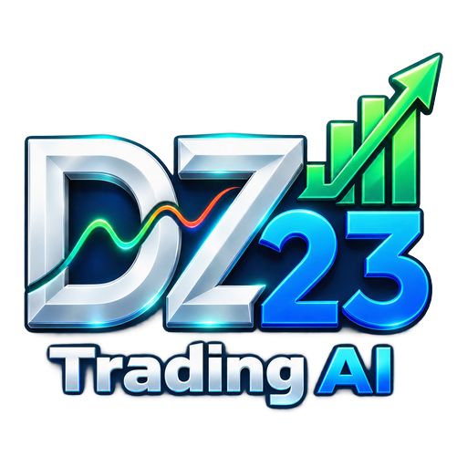

<p align="center">
  
</p>

# DZ23 Trading AI

Plataforma open source, **single-owner**, para pesquisa e operação de trading
com múltiplos agentes de IA: dez traders com estratégias distintas, um Maestro
central, gestão determinística de risco, execução governada, reconciliação,
auditoria e um painel visual em português. Um dono por instalação — sem SaaS,
sem multi-tenant, sem cobrança.

Roda **no Windows** (instalador próprio, sem exigir Python instalado) e, para
acesso remoto pelo navegador e pelo celular, numa VM Linux ARM64 (Oracle
Cloud) — preparado neste repositório, com homologação pendente de ambiente
real.

> **Aviso:** software experimental de pesquisa e engenharia. Não é
> recomendação de investimento, não garante lucro e pode causar perdas.
> O padrão é **PAPER/SHADOW**. **LIVE (dinheiro real) está bloqueado** por
> construção (fail-closed, quatro fechaduras explícitas) e permanece
> bloqueado até revisão técnica, operacional e regulatória independente.

## Estados de operação

| Estado | Envia ordens? | Situação |
| --- | ---: | --- |
| **PAPER** | Não (simula com ledger persistente) | Homologado no bundle Windows — evidências em [docs/mission/WINDOWS-RELEASE-EVIDENCE.md](docs/mission/WINDOWS-RELEASE-EVIDENCE.md) |
| **SHADOW** | Não (registra intenções e compara com o mercado) | Disponível nesta suíte; sem homologação real declarada |
| **DEMO** (MT5 conta demo) | Sim, somente em conta demo | Requer terminal e conta externos; **não validado neste repositório** |
| **LIVE** (dinheiro real) | — | **Bloqueado** — ver [LIVE-DINHEIRO-REAL.md](LIVE-DINHEIRO-REAL.md) |

O estado operacional é perguntado ao servidor (`/v1/status/operacao`) — o
painel não guarda texto fixo que envelhece na direção perigosa.

## O que o sistema faz

**Mesa multiagente (dez traders + Maestro)**
- Dez traders com estratégias realmente distintas — tendência, reversão à
  média, rompimento e variações —, cada um com regime de elegibilidade,
  invalidação da tese e razão explícita quando decide **não** operar.
- Um Maestro central coordena ciclos, prioridades e disputas; cada trader
  presta contas por resultado atribuído.
- Gate de evidência por trader: promoção de tier exige histórico compatível;
  pausar/retomar é ação explícita do dono.

**Risco e execução**
- Risco determinístico com poder de veto sobre a IA e **reserva atômica** —
  o mesmo capital nunca é prometido duas vezes.
- Executor único até a corretora, com máquina de estados, chave idempotente
  presa ao conteúdo do comando e **reconciliação** pós-timeout (sem reenvio
  cego, sem liberar reserva enquanto houver efeito possível).
- Contabilidade em partidas dobradas, resultado atribuído por trader e
  correção só por compensação.

**Inteligência quantitativa e IA externa**
- Laboratório quant: walk-forward, controle de vazamento, Monte Carlo,
  relatórios por estratégia.
- APIs externas de IA para notícias, sentimento, macro e explicações —
  informam decisões, mas **nunca enviam ordens**.

**Plataforma**
- Painel em português: Visão geral, Configuração, Análises, Mesa de Agentes,
  Trading Floor isométrica e Risco.
- Acesso do dono com senha em hash **Argon2id** e código de recuperação de
  uso único; assistente de primeira execução no próprio painel — nada de
  editar arquivos ou decorar comandos.
- Trading Floor e painel funcionam no celular (acesso remoto via HTTPS).

## Começar (desenvolvimento)

```bash
uv sync --locked --extra desk --extra dev
uv run uvicorn service.app:app --port 8080
```

Abra `http://localhost:8080/app`. Na primeira execução o painel mostra o
assistente: crie a senha do dono ali mesmo e guarde o código de recuperação
exibido uma única vez.

No Windows instalado, use o instalador dos releases — ele não exige Python
no computador e preserva os dados em atualizações. Passo a passo em
[COMECE-AQUI.md](COMECE-AQUI.md).

## Open source

- Licença: **Apache-2.0** ([LICENSE](LICENSE)); atribuições de terceiros em
  [NOTICE](NOTICE).
- [CONTRIBUTING.md](CONTRIBUTING.md) — como contribuir.
- [SECURITY.md](SECURITY.md) — política e reporte de vulnerabilidades.
- [DEPLOY.md](DEPLOY.md) — deployment em servidor (Docker Compose).
- Arquitetura: [docs/AGENCY-ARCHITECTURE.md](docs/AGENCY-ARCHITECTURE.md).
- Missão, checkpoints e evidências: [docs/mission/](docs/mission/).

**Nunca versione segredos.** Chaves de IA, credenciais de corretora, senhas,
tokens e bancos pessoais ficam no host (painel Configuração ou variáveis de
ambiente). Modelos sem valores reais: [`.env.example`](.env.example),
`.env.personal.example`, `.env.enterprise.example`.

## Qualidade

```bash
uv run ruff check .
uv run pytest -q                                # suíte completa
uv run --with playwright pytest tests/e2e -q    # E2E com navegador real
```

O CI verifica: suíte de testes em quatro versões de Python, lint estrito,
instalação limpa (sem extras), auditoria de dependências (pip-audit),
varredura de segredos (gitleaks), inventário de licenças (recusa copyleft
forte), SBOM (SPDX) e smoke tests de API/single-owner.

## Créditos e licença

Fork endurecido de
[TauricResearch/TradingAgents](https://github.com/TauricResearch/TradingAgents)
(Apache-2.0). A Trading Floor é código original DZ23, inspirada visualmente
em [Claw3D](https://github.com/iamlukethedev/Claw3D) e
[openclaw-office](https://github.com/wickedapp/openclaw-office) (MIT) — ver
[NOTICE](NOTICE). Corretoras via [ccxt](https://github.com/ccxt/ccxt) (MIT).
Licença deste projeto: ver [LICENSE](LICENSE).
